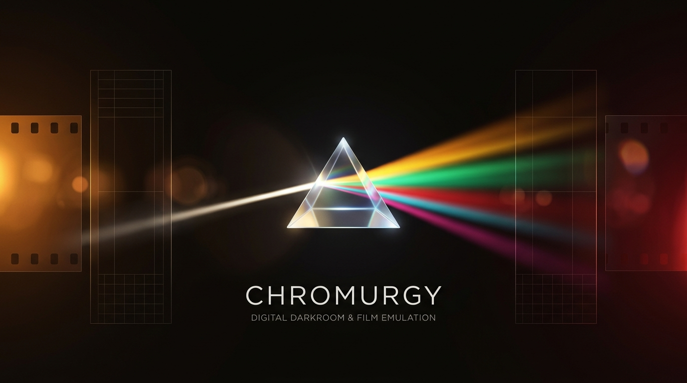

# Chromurgy

<p align="center">
  
</p>

<p align="center">
  <strong>An open-source digital darkroom for RAW development, film emulation and computational photography.</strong>
</p>

<p align="center">
  
  
  
  
  
  
  
</p>

---

## The Philosophy of Chromurgy

> **Chromurgy** (*Chroma* [Greek *χρῶμα*, color / spectrum] + *-urgy* [Greek *-(ο)υργία*, craft, transmutation, or transformative art as in *metallurgy* and *thaumaturgy*]) — **the art and craft of color transformation.**

### For Photographers Who Love Visual Character

Chromurgy was born for people who are familiar enough with photography to deeply love artistic processing, tactile film aesthetics, distinct camera color science, and expressive visual storytelling — **but have no desire to drown in the tedious, overwhelming complexity of heavy professional grading suites.**

Modern professional RAW processors often turn post-processing into an exhausting chore: endless menus, hundreds of technical sliders, masking layers, and color management curves. In that endless tweaking, the spark of inspiration is often lost.

**Chromurgy offers a different philosophy: simple, fast, enjoyable, and inspiring.**

* **No slider paralysis:** Work with cohesive aesthetic layers — legendary sensor color responses, authentic analog film emulsions, and physical optical traits.
* **Instant visual feedback:** Step into a clean, ambient digital darkroom designed for visual flow rather than technical micromanagement.
* **From digital negative to finished album:** Rapidly turn folders of RAW files into cohesive, gallery-ready collections and sync them directly to your self-hosted PhotoPrism library.
* **Focus on the craft:** Spend less time stuck in front of complex editors and more time out with your camera, enjoying the pure pleasure of seeing, composing, and shooting.

---

## The Journey to Release 1.0: From M-Film to Chromurgy

Chromurgy originally drew inspiration from the pioneering open-source **M-Film** project and its digital film emulation algorithms. We began by integrating its photochemical film emulation core to preserve faithful analog tonal characteristics.

However, throughout development leading up to **Release 1.0**, the project expanded into a far richer creative platform:

1. **Camera Looks Engine:** Beyond film stocks, we introduced mathematically calibrated color science modeling the unique spectral signatures of iconic digital sensors — from the lush, painterly Kodak CCDs in the Leica M8/M9, Nikon D200, and Pentax 645D, to the dual-diode dynamic range of the Fujifilm S5 Pro and the razor-sharp micro-contrast of the Sigma DP2 Merrill Foveon X3.
2. **Comprehensive Optics Engine:** We engineered a 14-operator optical simulation suite covering everything from vintage lens glass flaws (barrel distortion, lateral chromatic aberration, and edge falloff) to tilt-shift miniature perspectives, anamorphic flares, cross-screen starbursts, analog light leaks, bloom, and Ricoh HDF diffusion.
3. **Curated Combination Recipes:** 21 carefully orchestrated presets that harmoniously combine Camera Looks, Film Stocks, and Optical Stacks into one-click starting points for distinct moods.
4. **Interactive Web Darkroom:** A dedicated, keyboard-friendly browser studio with live reactive previews, collapsible workspaces, persistent batch rendering, and non-destructive versioning.
5. **Bidirectional PhotoPrism Integration:** Direct library ingest and publication that resolves source RAWs on the host without re-uploading large files through the browser.

Today, the original film simulation algorithms are just one component of a unified, versatile digital darkroom environment.

---

## Core Capabilities

### 📷 RAW Processing
* Direct processing of Canon `.CR2` / `.DNG`, Nikon `.NEF`, Sony `.ARW`, and camera rolls.
* High-precision demosaicing, highlight recovery, custom Kelvin / tint balance, and aspect-ratio crop controls.
* Non-destructive: your original RAW negatives are never overwritten or altered.

### 🎞️ Film Simulation
* Authentic tone transfer curves and photochemical dye response modeling.
* Legendary color negative, slide, and black & white stocks: Kodak Portra (160/400), Ektar 100, Tri-X 400, Fujifilm Velvia 50, Provia 100F, Classic Chrome, Ilford HP5 Plus, CineStill 800T, and more.
* Natural halation and deterministically seeded film grain synthesis.

### 🏛️ Camera Looks (CCD & Foveon Sensor Science)
* **Leica M8 & M9** — Kodak KAF-18500 CCD color rendition with classic warm micro-contrast.
* **Fujifilm FinePix S5 Pro** — Super CCD SR dual-photodiode dynamic range and skin tone handling.
* **Nikon D200** — Classic early-2000s warm CCD color rendition.
* **Pentax 645D** — Medium-format Kodak 40MP CCD richness and depth.
* **Ricoh GR III** — High-contrast Positive Film snapshot aesthetic.
* **Sigma DP2 Merrill** — Direct Foveon X3 three-layer sensor micro-contrast and punch.
* **Fujifilm X-Pro3** — Classic Negative documentary color balance.

### 🔮 Optical Effects Engine (14 Operators)
* **Compound Vintage Glass:** True geometric radial barrel distortion, lateral chromatic aberration, edge softness, and corner vignetting.
* **Selective Focus:** Tilt-Shift miniature perspective and Lensbaby sweet spot.
* **Flares & Atmosphere:** Anamorphic streaks, cross-screen starbursts, lens ghosting, analog light leaks, and optical vignetting.
* **Diffusion & Glow:** Ricoh HDF, Black Pro-Mist emulation, veiling flare, sunlight glow, halation, and Orton effect.

### 🎨 21 Curated Combination Presets
* Thoughtfully crafted recipes pairing looks, film, and optics (e.g. *Portra Glow*, *Moody Monochrome*, *Retro Travel*, *Cinematic Neo-Tokyo*, *Vintage Summer*, *Foveon Brutalism*).
* Completely editable: use presets as an instant foundation, then fine-tune any parameter.

### 🏠 Self-Hosted & Bidirectional PhotoPrism Sync
* Enumerate live PhotoPrism folders and albums directly within the Web Darkroom.
* Server-side RAW resolution: process high-resolution assets already residing on your host.
* Publish developed JPEGs back into chosen PhotoPrism collections with automatic indexing.

---

## Architecture Overview

```
+-------------------------------------------------------------------------------+
|                             Chromurgy Darkroom                                |
+-------------------------------------------------------------------------------+
                                      |
         +----------------------------+----------------------------+
         |                                                         |
         v                                                         v
+------------------+                                      +------------------+
|   Web Darkroom   |                                      |   Linux Server   |
| (Browser Studio) | <==== REST API / WebSockets =======> | (FastAPI Engine) |
+------------------+                                      +------------------+
         |                                                         |
         | Live Preview / Sliders / Presets                        |
         v                                                         v
+-------------------------------------------------------------------------------+
|                       Chromurgy Core Rendering Pipeline                       |
|                                                                               |
|   [ RAW Ingest ]                                                              |
|          |                                                                    |
|          v                                                                    |
|   [ White Balance & Demosaic ] (Custom Kelvin / As-Shot / Camera Profile)     |
|          |                                                                    |
|          v                                                                    |
|   [ Camera Look Layer ] (Leica M9, Fuji S5 Pro, Nikon D200, Sigma Foveon...)   |
|          |                                                                    |
|          v                                                                    |
|   [ Film Stock Layer ] (Portra, Tri-X, Velvia, CineStill, Ektar...)           |
|          |                                                                    |
|          v                                                                    |
|   [ Optical Effects Engine ] (Vintage Glass, Tilt-Shift, Flares, Bloom...)    |
|          |                                                                    |
|          v                                                                    |
|   [ Color Transform & Jittered Grain ] (Deterministically Seeded)             |
+-------------------------------------------------------------------------------+
         |                                                         |
         v                                                         v
+------------------+                                      +------------------+
| Full JPEGs / Web |                                      |    PhotoPrism    |
| (Export Library) |                                      |  (Auto-Publish)  |
+------------------+                                      +------------------+
```

---

## Quick Start

### Installation

```bash
# Clone the repository
git clone https://github.com/shohart/chromurgy.git
cd chromurgy

# Set up Python environment (Python 3.11+)
cd src/server
python3 -m venv .venv
source .venv/bin/activate
pip install -e .
```

### Running the Web Darkroom

```bash
# Launch the Chromurgy Web Darkroom server
chromurgy-web --host 0.0.0.0 --port 8766
```

Navigate to `http://localhost:8766/darkroom/` in your browser.

### Command-Line RAW Development

```bash
# Process a single RAW with a chosen film profile and recipe
chromurgy-develop --input sample.dng --profile Portra400 --recipe recipe.json --output result.jpg
```

---

## Documentation Navigation

| Document | Purpose |
|---|---|
| [AGENTS.md](AGENTS.md) | Agent contracts and active implementation guidelines |
| [00 Scope & Success](docs/00-scope-and-success.md) | Project boundaries, criteria, and acceptance gates |
| [01 User Experience](docs/01-user-experience.md) | Darkroom workflows, development, and sync |
| [02 System Architecture](docs/02-system-architecture.md) | Shared core, engine boundaries, and data flows |
| [05 Shared Film Core](docs/05-shared-film-engine.md) | Photochemical engine parity and versioning |
| [06 RAW Pipeline](docs/06-raw-dng-pipeline.md) | DNG/NEF decoding, color spaces, and geometry |
| [11 PhotoPrism](docs/11-photoprism.md) | Bidirectional library sync and publication |
| [18 Creative Requirements](docs/18-creative-look-requirements.md) | Creative looks and optical requirements |
| [19 Camera Looks](docs/19-camera-look-catalog.md) | Specification of all eight sensor looks |
| [20 Creative Pipeline](docs/20-creative-pipeline.md) | Color management, blending, and performance |
| [21 Optical Effects Engine](docs/21-optical-effects.md) | Optics algorithms, aberration formulas, and compounds |
| [27 Web Darkroom Product](docs/web/27-web-darkroom-product.md) | Product definition for browser darkroom |
| [28 Web UI](docs/web/28-web-darkroom-ui.md) | Layout, controls, and interaction design |
| [35 Curated Combinations](docs/35-curated-combination-presets.md) | 21 curated combination presets |
| [36 Presets Provenance](docs/36-combo-evidence-and-provenance.md) | Aesthetic provenance and references |
| [37 Wave Acceptance](docs/37-combo-waves-and-acceptance.md) | Release waves and verification suites |

---

## License

Chromurgy is free and open-source software distributed under the terms of the **GNU General Public License v2.0 (GPL-2.0)**.
See the `LICENSE` file for details.
