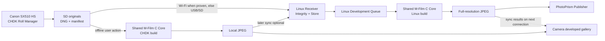

# 02 — System Architecture and Component Ownership

## Data flow



Linux **owns** high-quality rendering, RAW archival, persistent job state, catalog publication and result distribution. Camera **owns** exposure/roll state, temporary originals, capture UX, offline fallback and a local gallery. The common renderer **owns** film math, models, profiles, deterministic grain, and recipe semantics. Transport code owns only reliable bytes, not film decisions.

## Components

| Component | Runtime | Responsibility |
|---|---|---|
| `camera_port` | CHDK C module / custom build | Keys, UI, shutter metadata, filesystem, event hooks, capabilities |
| `roll_manager` | Portable C + CHDK storage adapter | Counts, immutable records, seal, resume, no-preview policies |
| `film_core` | **Same C sources** on Linux and camera | Film transform, curves, grain/halation behavior, deterministic seeds |
| `raw_adapter` | Linux and camera-specific adapters | Decode DNG, Bayer, color matrices, scaling, tile output |
| `camera_darkroom` | CHDK | User-invoked offline rendering; resource-bound image processing |
| `sync_client` | CHDK / host-assisted USB | Manifest, upload originals, receipt verification, result pull |
| `receiver` | Linux | Asset intake, auth, hashing, atomic commit, SQLite catalog |
| `develop_worker` | Linux | Work scheduling, CLI/shared-library invocation, rendition storage |
| `photoprism_publisher` | Linux | Publish only completed JPEGs, trigger/observe indexing |
| `camera_gallery` | CHDK | Show only developed renditions; local or downloaded results |

## Rendering boundary

Treat *DNG decode and normalization* as an adapter producing a well-defined, linear, color-managed image stream. Treat *film look* as one common portable core fed the same normalized colors, profile data and deterministic RNG seed. Host can use a robust desktop DNG decoder; camera can decode RAW with a constrained streaming implementation. Parity is measured **after normalizing input and output contracts** and may be impaired by differing demosaic/precision; do not mislabel distinct raw pipelines as pixel-identical.

## Network is opportunistic

Device initiates connections only while awake. No camera daemon persists through power-off. A local Wi-Fi access point plus server is enough; DNS/mDNS discovery is optional with direct static IP fallback. Linux server is always-on (systemd), with a durable queue and CLI import from a mounted card. USB/PTP may require server-initiated file pulls rather than device-initiated HTTP.

## Suggested logical repo layout (implementation, not included)

```text
src/
  shared/film_core/      # portable C, profiles, seeded grain
  shared/contracts/      # ID and serialization definitions
  camera/chdk/           # platform adapter, roll manager, gallery, sync
  camera/offline/        # constrained DNG & JPEG pipeline
  server/receiver/       # API, DB, auth, ingest
  server/worker/         # development worker wrapper
  server/photoprism/     # publisher and index integration
  host/cli/              # test developer, SD importer
fixtures/                # redistributable DNG/normalized test tiles
contracts/               # JSON schemas and OpenAPI
ci/                      # builds + parity tests
```

## Compatibility boundaries

- Never try to load Magic Lantern binaries on PowerShot/CHDK.
- Do not assume desktop program `Darkrooms` is open source: the public M-Film repo is camera-side GPL code only.
- CHDK on-device app can be a loaded module **if viable**; alternatively a selectively patched CHDK build. Do not add unnecessary permanently loaded core size.
- Keep data and protocol versions stable between firmware updates; versions must be explicit and migrations tested.
